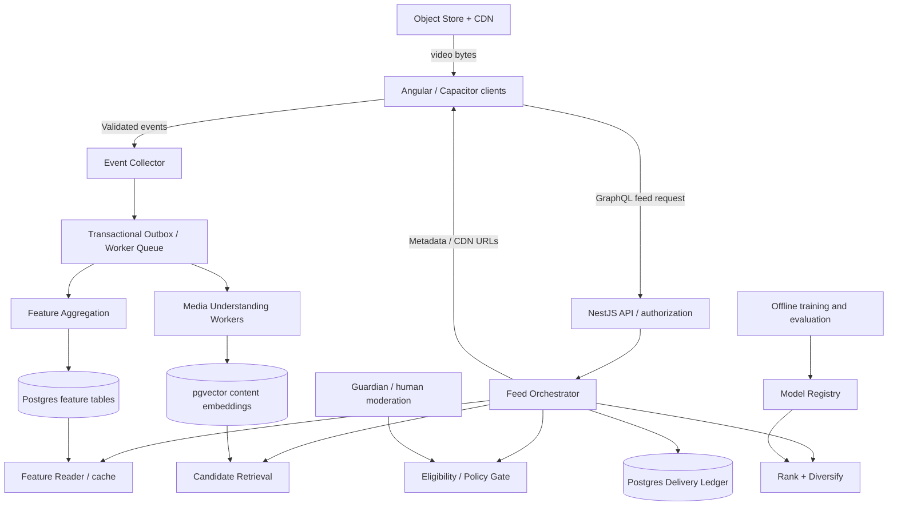

# MIND — Matterya Intelligence & Discovery

**Engineering handbook and agent execution guide**  
**Status:** Proposed architecture / implementation specification, not an assertion of existing deployed functionality  
**Version:** 1.0 · 2026-10-24  
**Audience:** Engineering leads, product, ML, data, trust & safety, privacy/legal, infrastructure, QA, and autonomous coding agents  
**Product stack:** Angular standalone, Capacitor (iOS/Android), NestJS GraphQL, PostgreSQL/Supabase, object storage/CDN; deploy targets currently include Render and GitHub Pages.  
**Brand:** Matterya; anonymous 18+ experience: Masquerade; intelligence platform: MIND.

> **Mission:** Deliver relevant, diverse, accountable discovery across Matterya without turning user activity into an uncontrollable surveillance profile. Personalization must serve user agency, creator opportunity, trustworthy communities, and commercial sustainability.

> **Agent execution rule:** This is a target specification. Before changing code, inspect the actual repository, document observed architecture and migrations, and reconcile any differences. Never assume a table, GraphQL operation, payment capability, or worker already exists. Implement behind feature flags, add tests, seek review for security/privacy/billing changes, and do not deploy or access production data without authorization.

## Table of contents

1. Purpose, scope, success and non-goals
2. Core design rules and invariants
3. Architecture and data flow
4. Repository layout and module ownership
5. Domain model and event contracts
6. Consent, privacy, Masquerade boundaries, security
7. Media understanding and feature extraction
8. Preference memory and feature computation
9. Candidate generation and retrieval
10. Ranking, diversity, cold start and explainability
11. No-repeat delivery, sessions and multi-device concurrency
12. Search, people, communities and world discovery
13. Guardian, fraud and trust workflows
14. Economy, creator monetization and ad boundaries
15. Interfaces: REST/GraphQL/events and versioning
16. Storage schema, indexes and migration strategy
17. Background workers and infrastructure
18. Training/evaluation/experimentation and model governance
19. Observability, SLOs, reliability and incident response
20. Testing and acceptance criteria
21. Implementation roadmap, ownership and tickets
22. Agent runbooks and prompt templates
23. Launch checklist, decisions and risk register
24. Appendices: examples and pseudocode

---

## 1. Purpose, scope, success and non-goals

MIND is **shared infrastructure** and **multiple specialized models/modules**, not one omniscient model. It powers recommendations for: short-form video, long-form video, text posts, creator discovery, world/country exploration, search, public communities, and a **separate** Masquerade recommendation environment. Future extensions: ads, creator insights, translations, accessibility and market intelligence.

### Product success criteria

- Recommend **eligible, unseen** content with a transparent feed mode and user controls.
- Improve measured satisfaction without relying only on viewing time; evaluate hides, saves, survey feedback, meaningful connections, creator opportunity and churn.
- Protect accounts, children, Masquerade pseudonymity, payment information and sensitive content.
- Support cold-start accounts, obscure interests, minority languages and new creators.
- Keep UI lightweight: recommendation/training services server-side; media delivered by CDN; bounded client prefetch.
- Ship an observable, testable baseline before complex ML; measure results against chronological and simple popularity baselines.

### Non-goals

- Reading third-party cookies or bypassing browser/OS restrictions.
- Cross-service fingerprinting or inferring protected personal attributes as a target.
- Training on private messages, paid-room content, or Masquerade data for the main feed without separately established lawful purpose, disclosure and controls; baseline explicitly excludes this.
- Silencing unpopular viewpoints based on opinion alone; enforcement is tied to published policy and applicable law.
- Delivering a guarantee that the user **actually saw** every item reserved by the server; see §11.
- Creating 12 separately deployed microservices on day one.

### Terms

- **Candidate:** content retrieved before ranking.
- **Impression:** validated client-side visibility event; not equivalent to delivery.
- **Delivery:** an API response containing a recommendation; written to durable ledger before response.
- **Reservation:** atomic claim of a video for one user's feed, before returning it.
- **Content family:** shared canonical media or near-duplicate uploads/reposts.
- **Eligible:** satisfies visibility, safety, availability, block, geographic, monetization and age rules.
- **Surface:** FOR_YOU_SHORTS, FOR_YOU_LONG, HOME_POSTS, EXPLORE, WORLD, SEARCH, MASQUERADE.
- **Namespace:** strict data/access partition, e.g. PUBLIC vs MASQUERADE.

## 2. Core design rules and invariants

1. **Server-derived identity:** authenticated principal comes from a validated token/session, never `userId` in a client event body.
2. **Hard constraints before soft scoring:** block/privacy/legal/age entitlements win regardless of relevance score.
3. **Permanent no-repeat for personalized For You delivery**, within configured canonical content identity and account lifetime; do not reuse after logout or reinstall. Manual navigations (saved items, creator profiles, direct links) may replay.
4. **Unique `(user_id, canonical_content_id, feed_scope)`** in durable PostgreSQL ledger; alternative scopes must be documented. Decide how videos reused across short/long feeds should dedupe before deployment.
5. **Immutable raw event ID**, deduplicated on ingest. Acknowledge at-least-once delivery; aggregates must be idempotent.
6. **Training-serving parity:** features and normalization definitions are shared/versioned.
7. **Time correctness:** record client occurrence time, server receipt time and ingestion time; bound skew; process late events safely.
8. **Fail closed for access/security**; fail gracefully for ML outages using an eligible deterministic ranking baseline.
9. **No direct cross-context profiling:** Public MIND cannot access Masquerade preference vectors, content history, room membership or identities.
10. **Explainability/user controls:** Why this, Not interested, hide creator, mute topic, adjust interests, reset personalization, chronological option.
11. **Minimization and expiry:** raw event retention and profile expiry must be approved and enforced, not indefinite by default.
12. **No unreviewed monetization bias:** sponsored recommendations explicitly labeled and separate from organic scoring.
13. **Every production ML change** requires offline validation, privacy review when relevant, staged experiment and rollback path.
14. **Accessibility:** subtitles, reduced-motion behavior, playback accessibility, keyboard and screen-reader support.

## 3. Architecture and data flow



**Request path:** Client requests batch → authenticate → read personal features → candidate sources → hard eligibility → exclusion ledger → lightweight rank → optional deeper model → diversify → reserve unique items atomically → sign/return small metadata payload → client streams separately → authorized interaction events → asynchronous aggregate.

**Non-request path:** New content → upload validation → transcode and thumbnails → transcript/vision/language/topic analysis → safety screening → embedding/index update → publish eligible candidate. Unfinished content stays `PROCESSING`, not recommendable.

**Operational separation:** The core NestJS API may import a RecommendationModule, but CPU-intensive processing runs as worker jobs; GPU services only when justified. Do not run model training within a GraphQL resolver. Feature reads should be bounded.

## 4. Repository layout and responsibilities

Suggested layout; adjust to actual repository:

```text
apps/
  web/                           # Angular web
  mobile/                        # Capacitor wrapper (if separate)
  api/src/
    auth/
    users/
    posts/
    videos/
    masquerade/
    intelligence/
      api/                        # resolvers, DTOs, guards
      events/                     # tracking ingest, validators
      feed/                       # orchestrator, cursor, policy
      retrieval/                  # sources, ANN/text/follows/trending
      features/                   # aggregation, cache, contracts
      ranking/                    # scorers, calibration, diversity
      exposure/                   # atomic ledger reservations
      experiments/                # deterministic assignment
      guardian-adapter/           # review status integration
      observability/
packages/
  contracts/                      # shared event + GraphQL types
  recommender-core/               # pure scoring functions
  policy/                         # eligibility policies
workers/
  media-analysis/
  feature-aggregator/
  offline-evaluation/
  model-training/                 # separate Python only when needed
db/migrations/
infra/
docs/mind/
```

**Boundaries:** API owns authentication and authorization; content service owns publish/delete; recommendation service only reads eligible content; payment service owns entitlements; Guardian owns moderation decisions; analytics owns derived aggregates, not permissions. Integrations must call stable interfaces, not reach into each other's internal tables without reviewed grants.

## 5. Domain model and event contracts

### Event envelope (version 1)

```json
{
  "event_id":"018f-event-uuid",
  "schema_version":1,
  "event_type":"video.progress",
  "surface":"FOR_YOU_SHORTS",
  "content_id":"uuid",
  "session_id":"random-session-id",
  "request_id":"feed-request-id",
  "delivery_id":"delivery-uuid",
  "occurred_at":"2026-10-24T19:00:00Z",
  "payload":{
    "position_ms":22000,
    "watch_ms":18000,
    "duration_ms":30000,
    "visible_fraction":0.95,
    "muted":false,
    "replay_count":0
  }
}
```

`account_id` is added **server-side** from auth. Clients must not send user IDs for identity determination. Use random IDs; do not place emails, exact GPS coordinates, access tokens or raw search terms in logs. Event DTOs are a strict allowlist. Never store arbitrary client-provided JSON without schema validation and maximum size.

### Recommended event taxonomy

- `feed.batch_requested`, `feed.delivery_reserved`, `feed.page_rendered` (server/client audit distinction)
- `video.impression` (≥50% visible for ≥1s, proposed definition), `video.play`, `video.progress`, `video.complete`, `video.replay`, `video.skip`
- `content.like`, `content.unlike`, `content.save`, `content.unsave`, `content.share`, `content.hide`, `content.not_interested`, `creator.follow`, `creator.unfollow`
- `search.submitted`, `search.result_clicked` (handle high-sensitivity queries with stricter redaction/retention)
- `room.joined`, `room.left`, `report.submitted`, `feedback.satisfaction` (separate Masquerade namespace)

### Event hygiene

- Require auth/explicitly scoped anonymous consent; throttle bots and duplicate bursts.
- Deduplicate `event_id` in DB or dedup cache with durable downstream semantics.
- Avoid per-millisecond heartbeats; batch playback checkpoints (e.g. every 5–10 seconds or state transitions), adapting for short clips.
- Reject impossible duration, negative watch time, progress beyond validated bounds, stale/invalid delivery IDs.
- Server calculates normalized playback ratios and quality flags.
- Event failure must not block playback; retry with exponential backoff and bounded local queue; discard on consent withdrawal when required.

## 6. Privacy, security and Masquerade

### Consent and purpose separation

Maintain a purpose inventory (`essential_session`, `personalization`, `analytics`, `advertising`, etc.) with region-aware legal review; don't presume all first-party tracking is exempt in the EU. Session authentication and personalized behavioral profiling are distinct activities. Publish plain-language notice, retention policy, download/delete/reset workflows, and consent changes. Log minimal auditable consent versions; don't use consent banners as a cover for unnecessary data collection.

### Masquerade isolation (architectural invariant)

- Users aged 18+ may enter only after the product's approved adulthood-eligibility check. Self-entered birthday alone is not independently verified age assurance.
- One globally unique persistent **Masquerade pseudonym** per underlying eligible account; disallow real names in the alias policy, but note automated real-name detection cannot guarantee a name is not real. Use a username availability service and moderation/report flow.
- Identity mapping held in restricted table/service with audit-logged access for narrowly authorized security, payment and lawful-response operations.
- Masquerade feature/event databases use a separate logical namespace and restricted service credentials. Do not expose regular account IDs in search indexes, room moderation tools, GraphQL responses, client analytics or exported logs.
- Public feed, ordinary friend suggestions, advertiser targeting and creator insights must **not** use Masquerade activity.
- Room moderators see the pseudonym and necessary action history, not underlying account identity. Pseudonym assignment is not a promise of absolute anonymity against platform operators, law enforcement processes, or identifying details users themselves disclose.
- Separate recommendation explanations, settings and deletion flows within Masquerade; room-level personalization can use only permitted Masquerade activity.
- Paid rooms: payment records link to restricted billing identity while creator dashboards reveal entitlements and aggregate earnings, not member public identities without explicit product semantics and review.
- Prevent cross-context timing/location leakage in notifications, cached URLs, event names, push payloads, analytics and deep links.

### Security baseline

TLS, secure session handling, least-privilege DB roles and RLS where applicable, credential rotation, encrypted sensitive mappings, signed media URLs where necessary, CSRF mitigation for cookie auth, CSP, validation, SSRF protections on media fetchers, rate limits, audit events, abuse and secret scanning. Do not publish service role keys to Angular or Capacitor. Authorize **every** API response, not only top-level list queries. Avoid direct database access from public clients for privileged recommendation history.

### User rights / regulations

Do formal review for GDPR, German tracking law (TDDDG), DSA, EU platform rules, Apple App Tracking Transparency when applicable, and app store billing/content policies. Make non-profiling feed options and appeal workflows visible as needed. Engineering document ≠ legal advice. Update policies by launch region.

## 7. Media understanding pipeline

**Upload state machine:** `INITIATED → UPLOADED → VALIDATING → TRANSCODING → ANALYZING → REVIEW_READY → PUBLISHED` or `REJECTED/FAILED` (retries with caps). Use signed direct-to-object-storage uploads; validate MIME by magic bytes, size/duration, codec, malware and media safety; prevent unsafe external URL fetches.

**Derived metadata:** language(s), subtitles/transcript, creator-provided text, text embedding, selected frame/visual embeddings, topics and confidence, entities where appropriate, format, duration, quality metrics and canonical duplicate signature. Avoid unnecessary facial identity recognition or sensitive inferred characteristics.

**Workers:** CPU transcription (e.g., faster-whisper if benchmarked), frame sampling, lightweight text embeddings, content safety classifiers, thumbnails, CDN transcode. Make model names/version and confidence accessible internally; manual corrections take precedence. Treat a missing transcript as `UNKNOWN`, not “not interesting”. Cost cap long videos: sample frames, batch inference, optimize by upload size and priority.

**Idempotency:** Job key `(content_id, pipeline_version, stage)`; publish only after required checks. Retry transient errors; dead-letter poison jobs. Reprocess on model updates without dropping public content unnecessarily.

**Near duplicates:** canonicalize originals/re-encodes/reuploads using robust fingerprints or perceptual hashes plus manual appeal workflow; don't confuse common footage with actual copyright infringement. For strict no-repeat, choose whether canonical-family dedupe is enabled (recommended if truly 'same video never again').

## 8. Interest memory and features

Maintain two contexts per user and surface: session and persistent. Keep explicit user topic choices separate from inferred preferences.

### Interactions → bounded reward (initial heuristic)

| Signal | Initial signed value | Notes |
|---|---:|---|
| Full attentive watch | +1.0 | Cap by duration; not equal to satisfaction |
| Replay | +0.7 | Cap repeated loops |
| Save | +1.8 | Strong intent |
| Share | +1.4 | May be critical share, not always agreement |
| Like | +1.1 | Undo must correct aggregation |
| Follow creator | +1.5 | Creator-specific affinity |
| Immediate skip | -0.5 | Account for autoplay/mis-swipe |
| Not interested | -3.0 | Explicit preference |
| Hide creator | Hard exclusion | Not just negative score |

Heuristics are **unvalidated startup defaults**. Calibrate and avoid optimizing against vulnerable users' engagement patterns.

### Interest update

For each topic `k` and event `e`:

`interest_next(k) = clamp(exp(-lambda*elapsed) * interest_prev(k) + eta*reward(e)*topic_weight(content,k), -B, B)`.

Session and long-term vectors read by scorer: `U = alpha * U_long + (1 - alpha) * U_session`, initially `alpha = 0.65` (test, not immutable). Separate decay constants; session TTL hours/days, persistent TTL longer but configurable. Track confidence and counts, do not treat a single event as a reliable preference. Respect mute/not-interested precedence. Support cold-start without creating fake certainty.

### Feature store versioning

Each derived feature row has `feature_version`, `computed_at`, `source_watermark`, `model_version`, `consent_purpose` and optional expiration. When a user resets personalization, invalidate caches, features and candidate queues immediately and purge retained events as appropriate for the disclosed policy. Nightly recomputation reconciles streaming updates.

## 9. Candidate generation

Query several independently tunable sources; over-fetch and deduplicate by canonical content ID:

1. From followed creators and opted-in subscriptions.
2. Content-topic and text/video embedding similarity (pgvector ANN with bounded filters).
3. Collaborative/co-watch candidates when data suffices and evaluation passes.
4. Recent trending content by locale/language, normalized for audience size.
5. New creators and underexposed eligible quality content.
6. Adjacent topics and exploration candidates.
7. World/country discoveries based on explicit user exploration, not precise location by default.

**Baseline retrieval budgets (adjust by benchmark):** assemble ~500–1,000 raw candidates, deduplicate, hard-filter, cheap-score top 100–200, full-score, rerank top ~30–50, reserve and return 10–15. The numbers are **proposals**, not fixed requirements. Restrict expensive ANN candidate generators by allowable visibility and publish status as well as post-filtering.

### Cold start

For new users: optional language/topic selection; regional/cross-cultural diversity without over-personalized location assumptions; editorial/safety-cleared popular recent content; boosted good new creators; rapid update from skips/saves. Do not force disclosure of sensitive interests. For new content: topic/video embedding retrieval and limited exploration test audience; monitor quality and safety; don't equate no followers with poor quality.

### Inventory exhaustion

Never violate no-repeat to hide lack of inventory. Return `hasMore=false`, an explicit end-state, and alternate actions (search/topics/follow creators); optionally allow a **user-initiated** replay mode labeled as such. Do not silently recycle old videos.

## 10. Ranking, diversity and control

### Baseline score

All numerical components normalized or calibrated to [0,1]; separate hard constraints:

`score = 0.30*satisfied_watch + 0.20*positive_feedback + 0.15*save_follow + 0.15*interest_match + 0.10*novelty + 0.10*quality - 0.25*negative_feedback_risk`

Above is a starter hypothesis, not a known secret algorithm. Include missing-feature defaults, safe bounds, model version and per-source scores in server-side diagnostics. Keep paid promotion out of hidden organic weights.

### Re-ranker

- Deduplicate canonical family and creator bursts.
- Enforce creator cap within a window (e.g. 2/10), adjustable by follow intent.
- Cap repeated topic clusters (e.g. 4/10) with exceptions for explicit topic feed.
- Include exploration target (illustrative 12 familiar / 4 adjacent / 3 new creator / 1 wildcard per 20; not strict at low inventory).
- Honor language accessibility and subtitle preferences.
- Diversity must not bypass safety, block and entitlement filters.
- Add novelty/serendipity cautiously; measure hide/skip/survey outcomes.

### Future contextual bandits

After enough traffic, evaluate contextual bandit exploration on *safe and eligible* candidates only. Measure long-term satisfaction and treatment fairness; off-policy evaluation before launch. Never perform high-risk personalization experimentation on sensitive personal contexts without explicit approvals.

### Explanations

Map a recommendation's **coarse contributing factors**, not exposing private behavioral trace: "Based on topics you follow", "Popular among viewers of similar educational content", "Exploring new creators". Provide controls to dismiss category/creator and clear history. Avoid claims that disclose another user's behavior.

## 11. Non-repeat guarantees and concurrency

### Contract and exact limits

**Strict mode:** a canonical video successfully **reserved for delivery** in personalized For You cannot be reserved again for the same account and scope. Applies across all devices/app restarts/login sessions. Does not prove it was displayed or watched. A crash after reservation can waste an unseen video. Manual revisit is allowed. Video-family hashing can't guarantee all visually similar edits are caught: define dedup scope, metrics and dispute process.

### Minimal schema

```sql
CREATE TABLE mind_feed_exposure (
  id uuid PRIMARY KEY DEFAULT gen_random_uuid(),
  account_id uuid NOT NULL,
  canonical_content_id uuid NOT NULL,
  feed_scope text NOT NULL,
  request_id uuid NOT NULL,
  delivery_id uuid NOT NULL UNIQUE,
  reserved_at timestamptz NOT NULL DEFAULT now(),
  impression_at timestamptz,
  watch_at timestamptz,
  CONSTRAINT mind_exposure_unique UNIQUE(account_id, canonical_content_id, feed_scope)
);
CREATE INDEX mind_exposure_account_time ON mind_feed_exposure(account_id, reserved_at DESC);
CREATE UNIQUE INDEX mind_exposure_request_content ON mind_feed_exposure(request_id, canonical_content_id);
```

Foreign keys, partitioning, deletion and account lifecycle require integration into real schema. **Do not use just a Bloom filter or client localStorage as the source of truth.** Bloom/Redis may accelerate prefiltering, but SQL owns the guarantee.

### Reservation algorithm

1. Authenticate account and authorize feed.
2. Validate `page_size`, surface and stable `request_id` idempotency token.
3. Re-read persisted response for matching retry id, if within retention; return it rather than reserving new content.
4. Retrieve and rank eligible candidates.
5. In one DB transaction, insert exposure records with `ON CONFLICT DO NOTHING RETURNING ...`; only return rows successfully inserted.
6. Recheck hard access conditions, ideally within the transaction or immediately before response; skipped inserts get replaced from the next candidate set.
7. Persist delivery batch and response order, commit, return metadata. Protect retries against request duplicates with per-account request uniqueness and locking.
8. Separately validate viewport impression and playback progress with `delivery_id`.
9. If inventory too small, return fewer results or an exhaustion signal. Do not repeat.

**Concurrency test:** two devices requesting at the same time must have disjoint canonical IDs; unique constraint is the authority. For request retry idempotency, lock/request record then replay the originally saved batch. Use transaction isolation carefully; no blanket serializable isolation without measuring contention.

**Pagination:** opaque signed cursor includes `feed_scope`, time, model version, session or batch reference and expiry (no sensitive user data). Cursor reuse doesn't bypass authorization. Return no unbounded offsets over a dynamic ranking index.

**Offline behavior:** preloaded videos have already been reserved. Offline consumption can display those only; avoid fabricating fresh unreserved recommendations. Upload batched events when reconnecting; event dedupe handles retries. Playback links expire and must refresh through authorized API.

## 12. Search, people, rooms and world

### Search

Combine lexical BM25/trigram/text queries, entity search, semantic vector retrieval, filters and personalization only within permitted purpose. Separate searchable visibility indexes. Return why-result signals only if safe. Respect language and transliteration; hard-block personal data leaks.

### Creator and people recommendations

Candidates from opt-in follows, topic overlap, creator content and explicit user interests. Exclude blocked/deactivated/private accounts; avoid showing contact-based matches without permission. No covert cross-context identity matching from Masquerade. Protect small-audience inferences and do not expose hidden follow relationships.

### World map

Use country-tagged/public content and user-selected map exploration. Do not infer or expose precise current location from app/device/IP for people discovery without express purpose and controls. Geospatial clustering must guard low-count deanonymization. Rank geographic diversity separately from popularity.

### Masquerade rooms

Separate retrieval/index and pseudonymous auth. Room roles, age gating, room-specific rules, private/paid entitlements, membership bans, ranking, discovery and reporting. Paid spaces not automatically recommended just because commission is higher. Creator identity to payer identity link is strictly billing-side; do not allow room creator to deanonymize members.

## 13. Guardian and integrity

Guardian provides signals and human-review dispositions for spam, copyright claims, policy violations, impersonation, harassment, threats, illicit content and coordinated manipulation. Distinguish allegation, automated classifier output, confirmed human decision and appeal state. Avoid treating disagreement as abuse merely because it produces reports.

**States:** `UNREVIEWED`, `AUTO_LIMITED` (narrowly scoped), `IN_REVIEW`, `APPROVED`, `REMOVED`, `APPEALED`, `RESTORED`. High-risk legal handling uses separately reviewed processes. Content publication, eligibility and recommendation availability must reflect current disposition promptly and invalidate caches.

Fraud: detect impossible playback, event farms, repeated self-engagement, bot clusters, creator-revenue manipulation and ad invalid traffic. Down-weight suspect analytics pending review, keep appeal route and audit trail. Avoid exposing detailed detection thresholds in public APIs. Do not share identifiable Masquerade interests with economy models.

## 14. Economy and advertising boundaries

- Clearly mark sponsored items. Separate ads placement engine and audit log from organic recommendation ranking.
- Record eligible ad impressions server-side/client-verified according to provider rules; validate fraud before creator allocation.
- Long form: compute **eligible net ad revenue** attribution; Shorts: platform creator pool with qualified engagement formula, reconciled per accounting period.
- Paid rooms, channel memberships, tips and premium content: payment service source of truth; recompute creator shares from settled amounts (tax, store fees, processor charges, refunds, chargebacks), not hypothetical gross sales.
- Advertisers may target permitted broad context, topics, geographies and consented audience features; **do not use Masquerade-sensitive discussion activity** for identified ad targeting.
- Creators receive transparent payout reports, adjustment records and appeal/dispute channels. Minimum payout thresholds, tax handling, chargeback reserves and KYC requirements must be legally reviewed.
- Ad auction/price optimization and creator payout calculations are independent audited subsystems; don't silently tune feed rank to maximize platform commission.

## 15. APIs and protocol contracts

### GraphQL baseline

```graphql
scalar DateTime

enum FeedSurface { FOR_YOU_SHORTS FOR_YOU_LONG HOME_POSTS EXPLORE WORLD MASQUERADE }

type FeedItem {
  contentId: ID!
  deliveryId: ID!
  creator: PublicCreatorSummary
  title: String
  durationMs: Int
  thumbnailUrl: String
  playbackUrl: String
  recommendationReason: String
  isSponsored: Boolean!
}

type FeedPage {
  items: [FeedItem!]!
  nextCursor: String
  hasMore: Boolean!
  requestId: ID!
  modelVersion: String!
}

input FeedRequest {
  surface: FeedSurface!
  limit: Int = 12
  cursor: String
  requestId: ID!
}

input BehavioralEventInput {
  eventId: ID!
  schemaVersion: Int!
  eventType: String!
  surface: FeedSurface!
  contentId: ID
  sessionId: String!
  deliveryId: ID
  occurredAt: DateTime!
  payload: String!
}

type EventReceipt { accepted: Int!, rejected: Int! }

type Query { personalizedFeed(input: FeedRequest!): FeedPage! }
type Mutation { ingestBehaviorEvents(events: [BehavioralEventInput!]!): EventReceipt! }
```

**Implementation note:** `payload: String` is an illustration of transport shape only; prefer validated typed union/versioned event DTOs in production, not unconstrained strings. Generate frontend contracts, require auth, validate limits and request scopes. Masquerade may be on distinct GraphQL endpoint/guard or separate resolvers with service/DB isolation. Avoid displaying underlying account identifiers in Masquerade response types.

### Example errors

`UNAUTHENTICATED`, `AGE_VERIFICATION_REQUIRED`, `CONSENT_REQUIRED` (for optional modes), `SURFACE_UNAVAILABLE`, `RATE_LIMITED`, `INVALID_CURSOR`, `ENTITLEMENT_REQUIRED`, `INVENTORY_EXHAUSTED` (or `hasMore=false`), `FEATURE_DISABLED`.

### Versioning

Version event schemas, ranking models, feature definitions, GraphQL fields and job payloads independently. For breaking migrations implement dual write/read or adapters, backfill and rollback. Document producer/consumer compatibility. Never rename event fields in place without migration.

## 16. Data schema and indexes

Use migration tooling in the existing project. Core proposed tables:

| Table | Keys / essential fields | Owner |
|---|---|---|
| `mind_event_log` | event_id PK; account reference, surface, type, times, sanitized payload, consent version | events |
| `mind_event_outbox` | message_id PK; delivery state, attempts, next_retry | events |
| `mind_content_features` | content_id, feature/model version, topics, language, quality, status | content |
| `mind_content_embeddings` | content_id, model_version, vector, updated_at | retrieval |
| `mind_user_interests` | account_id, surface, feature_version, topic, score, confidence, updated_at | features |
| `mind_user_creator_affinity` | account_id, creator_id, score, updated_at | features |
| `mind_session_features` | account_id, session_id, expiry, feature blob | features |
| `mind_feed_exposure` | unique account/canonical content/scope; request/delivery IDs | exposure |
| `mind_feed_batch` | account/request unique; order; model_version, payload/replay info | exposure |
| `mind_model_registry` | model_id/version, artifact ref, metrics, status | ML ops |
| `mind_experiment_assignment` | experiment/account unique; variant; enrolled_at | experiments |
| `mind_ranking_feedback` | delivery_id, event_id, impression/watch/negative signals | analytics |
| `mind_policy_decision` | content_id, disposition, reviewer, appeal link, timestamp | guardian |
| `masquerade_mind_*` | independently scoped equivalents with anonymous principal | Masquerade |
| `identity_mapping_restricted` | account ↔ pseudonym (access controlled, audit) | identity |

Critical indexes: `(account_id,reserved_at DESC)`, unique `(account_id,canonical_content_id,feed_scope)`, `(content_id,model_version)`, `(surface,topic,computed_at)`, ANN vector index appropriate to pgvector version, `(event_type,server_received_at)` by retention partitions. Add partitions only after volume and benchmarks justify. Define foreign keys, cascading deletion behavior and service principals in design review. Avoid N+1 GraphQL queries and unindexed exclusion scans.

**PostgreSQL scaling:** exposure ledger grows approximately with delivered item count. Forecast 1M users × 50 reserved videos/day = **50M rows/day** (hypothetical upper-scale scenario). At that scale, naive forever-per-row storage is costly: design lifecycle, partitioning, archived unique-index semantics, and compressed canonical seen sets **without weakening the no-repeat invariant**. At early scale, simple PostgreSQL constraints are preferable. Record exact account lifecycle data-retention policy before promising 'forever' for deleted accounts.

## 17. Jobs, caching, deployment and scaling

### Start small

- **Phase 1:** NestJS modular monolith + Supabase Postgres + pgvector + background worker on Render (or alternative). Use PostgreSQL outbox and a worker polling with `SKIP LOCKED` for reliability, if volume permits.
- **Phase 2:** Redis for hot session features/candidate cache and distributed limits, if measured value. Never make Redis the only record for exposures/payment state.
- **Phase 3:** event broker (Kafka/Redpanda or managed equivalent), dedicated feature store/warehouse, ANN search service, inference servers when throughput justifies complexity.

### Cache contracts

Cache keys include model/version/surface/namespace/consent version where relevant. TTLs short for eligibility-sensitive results; invalidate on blocks, removals, entitlements and user resets. Never cache a **deliverable batch globally across users**. Cache candidate IDs, not per-user final exposures. Redis outage falls back to DB-bound safe path.

### Cost disciplines

- Stream from CDN, not NestJS/Render backend.
- Client limits: current video plus next 1–2 media prefetches under network/battery conditions; reuse a small player pool; cancel obsolete requests.
- Cap API batch size (e.g. 12) and event payload size; avoid unbounded polling.
- Transcribe/embeddings asynchronously, prioritize watched/public media, store output with versioning.
- Use aggregate features and bounded online candidate counts rather than running expensive models over the entire catalog.
- Monitor Supabase egress, object-store ingress/egress and CDN hit rate separately. Query/index costs and event write volume are first-class budgets.

### Deployment and rollout

Separate dev/staging/prod, secrets and roles. CI includes lint, typecheck, contract, migrations, test, security scan. Prefer expansion-compatible migrations, backup + restore drill, feature flags and canary release (e.g. internal → 1% → 5% → 25% → 100%) with defined abort thresholds. No automatic unreviewed rollout from coding agents.

## 18. Machine learning evaluation and experiments

### Baselines

A: chronological/followed content. B: eligible popularity-based ranking. C: weighted feature ranking. Compare under consistent candidate inventory and no-repeat rules.

### Offline metrics

Ranking: NDCG@K, Recall@K, MAP where meaningful, calibration/Brier loss, coverage, diversity, novelty, creator exposure inequality, cold-start performance, multilingual performance. Distinguish observed engagement labels from actual satisfaction. Split data by time; prevent identity/session leakage across train/eval.

### Online metrics

Qualified watch satisfaction, negative feedback per 1k deliveries, meaningful saves/shares, return rate, survey response, creator discovery, new creator activation, language/topic coverage, report and appeal outcomes. Guardrails: feed p95 latency, crash/ANR, data cost, moderation load, minors exposure and privacy incidents.

### A/B framework

Deterministic assignment by HMAC(experiment_id + stable pseudonymous account key), stratification and holdout where useful; consistent sticky treatment across devices. Track exposure as distinct from mere assignment; do not sample participants based on post-treatment outcomes. Monitor SRM (sample ratio mismatch), guardrails, novelty effects and segment fairness. Rollback instantly via flags; preserve reproducible configs and evaluations. Experimental design, consent and policy review for sensitive cases.

### Model governance

Registry includes: version/hash, data provenance, training cutoff, consent filters, hyperparameters, feature schema, offline results, test cases, bias/fairness review, security review, canary metrics, owner, rollback artifact and retention. Maintain deterministic fallback when model service fails.

## 19. Observability and reliability

Proposed **initial** targets (revise from measured baseline): warm-cache feed API p95 <300 ms for metadata, p99 <1s excluding video transfer; event ingest availability ≥99.9%; duplicate delivered-video count = 0 for strict feed scope; media pipeline completion within target SLA by duration tier; 100% denied unauthorized Masquerade identity mapping requests; near-zero missing experiment assignment. Distinguish application latency from CDN/player startup.

Dashboards:

- API request duration p50/p95/p99 by resolver/surface/model; DB time, cache hit, retrieval stage timing, ranking time.
- Number candidates per source, eligibility rejection reasons, diversity coverage, empty-feed frequency.
- Exposure uniqueness conflicts, idempotent replays, duplicate incidents and rate of reservations without impressions.
- Event ingestion lag, outbox retry/dead-letter counts, clock skew and feature freshness.
- Worker time and cost per video minute; media transcode errors, failed transcripts.
- CDN bytes/user/day, start latency, rebuffering, crash/ANR.
- Guardian turnaround, appeal reversals, fraud rates.
- Consent/reset/delete completion, access audit anomalies and data-retention backlog.
- Monetization ledger reconciliation failures and invalid ad traffic.

Alerts need owners, severity, runbook, paging policies and false-positive tuning. Never put full private payloads in logging/tracing. Sample safe structured traces. Rehearse restoration, exposure-table corruption containment, queue backlog and ML outage fallback.

## 20. Tests and acceptance gates

### Unit tests

Pure score normalization; decay; negative feedback; thresholds; deterministic experiment allocation; cursor encode/decode; source dedupe; topic/creator diversity; hard policy constraints; missing features; zero/infinite values; replay counting.

### Integration tests

PostgreSQL uniqueness under real parallel transactions; batch idempotency; outbox processing exactly-once **effects** despite at-least-once delivery; auth guards; consent controls; deleted/blocked content invalidation; Masquerade auth scope; paid room entitlement changes; mobile reconnect/out-of-order events.

### End-to-end

1. New account completes onboarding → gets eligible feed; never receives blocked/restricted content.
2. Two devices concurrently fetch → no overlapping canonical video IDs.
3. App crashes after delivery → reopening doesn't repeat the reserved video.
4. Network retries with same request ID → identical ordered batch, no extra reservation.
5. Inventory exhausted → honest empty state, no recycled video.
6. User hides topic/creator → constraints enforced next fetch and after cache expiration/invalidation.
7. User resets personalization → stale features and caches not served.
8. Age-restricted content/account denied reliably.
9. Masquerade anonymous activity never appears in public feed, normal search, notifications, ad profile, creator dashboard or account export lacking proper authorization.
10. Moderation removal → candidate index and cache invalidation; appeal restoration reversible.
11. Subscription expires/chargeback → room access changes through the entitlement service.
12. Unsupported language/low-data network → playback and fallback ranking remain usable.

### Load and fault tests

10× baseline peak, realistic data distributions; Redis down, worker down, DB degraded, CDN 404, stale feature schema, model server timeout; graceful degradation. Record quantitative test results in release documents. Never assume readiness from a successful local smoke test alone.

### Acceptance checklist for each ticket

- Requirement linked; implementation notes and threat surface.
- Unit/integration/e2e updates where applicable.
- Migration reversible or roll-forward documented; perf impact measured.
- Authorization/consent/retention checked; Masquerade isolation checked.
- Metrics/logging without sensitive data; feature flag and rollback.
- API/contract/documentation updated.
- Reviewer approval; staged deployment and monitoring window.

## 21. Implementation roadmap and division of labor

### Phase 0 — Repository/requirements audit (must complete first)

**Deliverables:** architecture inventory; real existing user/video schema; auth path; storage providers; current engagement events; moderation/age gating status; consent controls; deployment constraints; cost baseline; product decisions list. No premature rewrite.

### Phase 1 — Vertical slice: reliable feed

- MIND-001: shared contracts and versioned event taxonomy.
- MIND-002: authenticated event ingestion, validation, dedup and outbox.
- MIND-003: video publish eligibility and normalized metadata read model.
- MIND-004: exposure ledger migration, transactional reservation, idempotent batches.
- MIND-005: deterministic retrieval (recent/follows/topic), ranking and diversity.
- MIND-006: GraphQL resolver, bounded cursor, frontend player instrumentation.
- MIND-007: negative feedback controls, reset and chronological alternative.
- MIND-008: concurrent/multi-device no-repeat integration tests.
- MIND-009: dashboards, feature flags, load testing and rollback.

**Gate:** Pass concurrency test, authorization, no-repeat, consent, latency and security review on staging; controlled production rollout.

### Phase 2 — Content intelligence

- MIND-010: media transcription/frame and embedding jobs.
- MIND-011: content feature registry/versioning, multilingual metadata.
- MIND-012: pgvector retrieval and topical candidate blending.
- MIND-013: feature aggregation with event time, confidence and decay.
- MIND-014: experiment infrastructure and offline evaluator.

**Gate:** Semantic retrieval beats baseline on offline and gated online metrics without privacy regression.

### Phase 3 — Adaptive intelligence

- MIND-015: collaborative candidate retrieval with cold-start fallback.
- MIND-016: trained ranker service with model registry.
- MIND-017: session feature updates and monitored reranking.
- MIND-018: creator opportunity and diversification optimization.
- MIND-019: explainability and user-interest controls expansion.

**Gate:** Generalization, fairness, user satisfaction and operating cost demonstrated.

### Phase 4 — Other product surfaces

- MIND-020: search semantic/keyword hybrid.
- MIND-021: people and creator discovery with privacy review.
- MIND-022: world/country feed and geoprivacy review.
- MIND-023: Masquerade-only identity, room retrieval/ranking and isolation tests.
- MIND-024: Guardian signal/policy integration, appeal propagation.
- MIND-025: creator insight dashboards, payment/ad auditing integration.

### Phase 5 — Scaling (only after observed need)

Feature store, broker, warehouse, trained sequence models, multi-region service design, ANN cluster, model-serving autoscaling; each requires a benchmark-based architecture decision record and projected operating expense.

### Suggested workstream ownership

| Role / agent | Ownership | May not autonomously decide |
|---|---|---|
| Tech lead / Architect | ADRs, interfaces, migration plan, compatibility | Legal bases, unsafe production changes |
| Backend agent | NestJS modules, API, SQL, auth integration | Grant itself elevated credentials |
| Data agent | event pipelines, feature definitions, quality | Add unrestricted sensitive collection |
| ML agent | feature engineering, retrieval, rank/evaluation | Ship model without experiment/approval |
| Web/mobile agent | feed UI, event batching, playback, controls | Trust client flags for auth/age |
| Security/privacy agent | threat model, scope guards, retention/audit | Claim legal sign-off on its own |
| Trust agent | policy-engine adapters, appeals/test cases | Apply unpublished viewpoint-based rules |
| Payments agent | entitlements/ledger reconciliation integration | Release or alter funds autonomously |
| QA agent | invariant tests, concurrency and load suite | Skip production acceptance gate |
| Product lead | success metrics, controls, policy choices | Pretend hypotheses are validated results |

## 22. Agent runbooks and prompt templates

### Universal instructions for coding agents

1. Read this handbook and relevant existing documents, inspect actual repo and active branch.
2. State task scope, affected modules, acceptance criteria and assumptions in ticket/PR.
3. Identify data-sensitive paths and authorization guards before implementation.
4. Prefer narrow change over wholesale rewrite; reuse existing conventions, shared types and migrations.
5. Implement with tests, metrics and documentation; never fabricate passing tests.
6. Run lint/types/tests and report exact commands/results; distinguish unrun tests.
7. Add migration and rollback instructions; describe effect on existing users and events.
8. Never log secrets, fetch unapproved real user data, alter billing or deploy production without explicit human approval.
9. Do not bypass policy/consent to improve model performance; escalate unresolved decisions.
10. Hand off artifacts: code path list, public contract changes, runbook, risks, blockers and next owner.

### Template: Architecture / ADR agent

```text
Task: Evaluate [specific feature] against Matterya MIND handbook v1.0.
Inspect current repo and document actual code paths. Propose 2–3 feasible approaches,
including data isolation, consistency, latency, cost, migrations, failure modes and
rollback. Select a proposed approach with explicit assumptions and unresolved
questions. Output ADR in docs/mind/adr/ and no production changes without review.
```

### Template: Backend implementation agent

```text
Task: Implement ticket MIND-00X only.
Read docs and inspect current NestJS GraphQL modules, auth and Supabase schema.
Implement server-side user identity, authorization, input validation, idempotency,
transaction semantics and typed contracts. Add unit + Postgres integration tests,
metrics, migration, rollback and minimal documentation. Do not deploy or access
production. Report changed paths, test results and deviations from handbook.
```

### Template: ML experiment agent

```text
Task: Design a measurable improvement to candidate retrieval/ranking.
Define baseline, objective, feature inventory, permitted data scope,
offline train/time split, candidate filters, guardrails, cold-start segments,
privacy implications, expected inference cost and rollback. Produce reproducible
scripts and experiment readout. Do not claim live improvement without online test.
```

### Template: Security verification agent

```text
Task: Threat-model and test MIND [feature].
Check auth and IDOR, Masquerade linkability, RLS/service-role credentials,
cache/log/push leaks, replay/idempotency abuse, payment entitlement enforcement,
rate limiting, retention and consent transitions. Provide prioritized findings,
reproduction steps using test fixtures only, and proposed remediations.
```

### Template: QA release agent

```text
Task: Produce staging readiness report for [release/version].
Execute the agreed no-repeat concurrency suite, cross-device tests, inventory
exhaustion, blocked content, Masquerade isolation, reset, outage fallback,
latency and observability checks. Attach commands, logs without personal data,
actual observed results, unresolved defects, go/no-go recommendation.
```

### PR template

```markdown
## Problem / ticket
## Design and why
## Changed components and contracts
## Database and data-retention impact
## Security / privacy / Masquerade scope
## Experiment, performance and cost impact
## Tests run (commands and results)
## Feature flag / rollback
## Known risks and follow-up
## Reviewer approvals
```

## 23. Decisions, risks, and launch gates

### Decisions that must be explicitly approved

1. Does no-repeat operate across Shorts and Long Video together, or per-surface? Suggested: same canonical media across all personalized video surfaces to honor plain-language promise.
2. How does the system treat substantially edited reposts and licensed reused footage?
3. What is the user-facing choice for chronological and non-profiling feeds?
4. Which behavioral events require consent per market, and what is the retention period?
5. Should Masquerade use persistent aliases per account across all rooms (user requirement) and optional per-thread visual anonymity? Define consistency and exposure risks.
6. Are Masquerade posts searchable outside Masquerade? Suggested: no.
7. Can creators charge recurring/one-off room participation fees; which checkout by country/platform? Separate legal and app-store review.
8. What content is age-restricted and what qualifies as trustworthy age assurance?
9. How much new-creator exploration is acceptable before user experience suffers?
10. Which cost ceiling/month, data locality and inference provider satisfy operating constraints?

### Risk register (initial)

| Risk | Severity | Mitigation / owner |
|---|---|---|
| Masquerade identity leakage | Critical | Restricted mapping, no cross-context features, penetration tests; security lead |
| Duplicate feed deliveries | High | Postgres uniqueness + concurrency tests; backend lead |
| Unbounded exposure ledger | High at scale | Forecasting, storage architecture and retention compliance; DBA |
| Event farming / payout fraud | High | Signed delivery refs, anomalies, reconciliation; trust/economy |
| Legal/nonessential tracking compliance | High | Purpose inventory, legal review, controls; privacy lead |
| Content safety false positives | High | Human appeals, confidence thresholds, auditing; Guardian |
| Model feedback loops / filter bubbles | Medium–High | Horizon, diversity, user controls, evaluations; ML |
| GPU/transcription expense | Medium–High | Async bounded processing and cost telemetry; infra |
| Stale moderation cache | High | Invalidation and just-in-time access check; backend |
| Inaccurate satisfaction metric | Medium–High | Multi-metric surveys and holdouts; product/ML |
| Vendor/network outages | Medium | Safe fallbacks, retry/dead-letter, CDN separation; SRE |

### Launch gates

- [ ] Product decisions documented and user-facing promises accurate.
- [ ] Staging migration and rollback rehearsal complete.
- [ ] Consent, retention, age gating and policy reviews complete for launch geography.
- [ ] No-repeat cross-device collision tests pass with real DB concurrency.
- [ ] GraphQL auth and data isolation penetration checks pass.
- [ ] Masquerade cross-context leakage checks pass (if released).
- [ ] Content policy pipeline and human appeals operational.
- [ ] Performance/cost measurements from realistic load recorded.
- [ ] Observability dashboards and on-call escalation operational.
- [ ] Feature flags/canary and rollback practiced.
- [ ] Account export, reset and deletion tested.
- [ ] Creator payouts/paid rooms separately financially and legally reviewed before enabled.

## 24. Appendices

### A. Core feed pseudocode

```typescript
async function personalizedFeed(principal, input) {
  authorizeSurface(principal, input.surface);
  const requestId = validateRequestId(input.requestId);
  const replay = await batches.findByAccountAndRequest(principal.id, requestId);
  if (replay) return authorizeAndReplayBatch(principal, replay);

  const [features, candidates] = await Promise.all([
    featureReader.forPrincipal(principal, input.surface),
    retrieval.retrieve(principal, input.surface, { max: 1000 })
  ]);
  const allowed = await policy.filterEligible(principal, input.surface, candidates);
  const unserved = await exposures.excludeDelivered(principal, input.surface, allowed);
  const scores = ranker.scoreBatch(features, unserved);
  const ordered = diversify(scores, { creators: true, topics: true });

  // Server transaction: stable request id, insert-on-conflict, batch snapshot.
  // Never return unsuccessful reservations or fail open around access rules.
  return exposureService.reserveAndPersistBatch({
    principal, requestId, surface: input.surface, ranked: ordered,
    size: Math.min(Math.max(input.limit ?? 12, 1), 20)
  });
}
```

### B. Example transactional logic (conceptual)

```sql
-- Inside controlled transaction, after locking/creating unique
-- (account_id, request_id, feed_scope) batch record.
INSERT INTO mind_feed_exposure
 (account_id, canonical_content_id, feed_scope, request_id, delivery_id)
SELECT :account, proposed.canonical_id, :scope, :request_id, proposed.delivery_id
FROM proposed
ON CONFLICT (account_id, canonical_content_id, feed_scope) DO NOTHING
RETURNING canonical_content_id, delivery_id;
-- Persist only successfully inserted rows in ordered batch response.
-- Commit before returning media metadata.
```

**Important:** A SQL `INSERT ... SELECT ... LIMIT 12` can return fewer than 12 if candidates conflict; retrieve replacements and retry a bounded number of times. Idempotency must cover the whole batch, not merely each row. If a commit succeeds but HTTP response fails, the retry must retrieve the same batch.

### C. Simple feature worker pseudocode

```python
def apply_event(event):
    if already_processed(event.event_id):
        return
    account = server_resolved_principal(event)
    if not eligible_for_processing(account, event.surface, event.purpose):
        mark_processed_without_features(event.event_id)
        return
    features = load_features(account, event.surface)
    features = decay_to(features, event.server_received_at)
    reward = bounded_reward(event)
    for topic, weight in content_topics(event.content_id):
        features[topic] = clamp(features[topic] + reward * weight, -B, B)
    persist_features_and_processed_event_atomically(features, event.event_id)
```

### D. Example ADR title list

- ADR-001: Exposures strict uniqueness scope and canonical media family.
- ADR-002: Authentication and session strategy on web vs Capacitor.
- ADR-003: Masquerade service/data isolation and billing mapping.
- ADR-004: Event ingestion with PostgreSQL outbox vs broker.
- ADR-005: Ranking model strategy and online serving runtime.
- ADR-006: Consent/retention and regional controls.
- ADR-007: Video storage/transcoding/CDN and signed URL lifecycle.
- ADR-008: GraphQL pagination and batch idempotency.
- ADR-009: Experiment assignment identity and metric definitions.

### E. Documentation that should accompany implementation

`README.md` quickstart; `ARCHITECTURE.md` diagrams; `DATA_DICTIONARY.md`; `EVENT_CATALOG.md`; `POLICY_MATRIX.md`; `PRIVACY_DATA_FLOW.md`; `MODEL_CARDS/`; `EXPERIMENTS/`; `RUNBOOKS/`; `ADRs/`; `SCHEMA_MIGRATIONS.md`; `RELEASE_CHECKLIST.md`; `OPERATING_COSTS.md`; `KNOWN_LIMITATIONS.md`.

### F. Public research starting points

- YouTube recommendations: https://research.google/pubs/deep-neural-networks-for-youtube-recommendations/
- TensorFlow Recommenders (two-tower concepts): https://www.tensorflow.org/recommenders
- PostgreSQL `INSERT ... ON CONFLICT`: https://www.postgresql.org/docs/current/sql-insert.html
- pgvector: https://github.com/pgvector/pgvector
- OpenTelemetry concepts: https://opentelemetry.io/docs/concepts/
- EU Digital Services Act: https://digital-strategy.ec.europa.eu/en/policies/digital-services-act-package
- EDPB guidance hub: https://www.edpb.europa.eu/our-work-tools/our-documents_en

**End of handbook.** First action for every team member or autonomous agent: run Phase 0 against the actual Matterya repository, file unresolved ADRs, then implement Phase 1 as a fully tested vertical slice. Future sophistication must be earned by evaluation results, not by service count.
